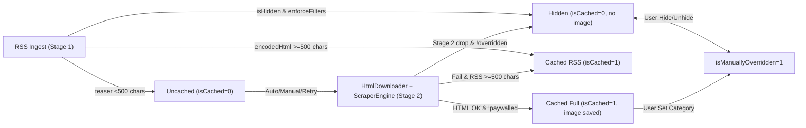

# Offline Browser (BackLine) — Architecture Context Spec

Android/Kotlin offline-first reader (`com.example.offlinebrowser`, `minSdk=24`, `compileSdk=34`, `targetSdk=34`, JVM 17, Room SQLite v11).

---

## 1. Repository Map & Import Hierarchy

```text
/workspace
├── build.gradle.kts / settings.gradle.kts / gradle.properties / gradlew  # AGP 8.2.0, Kotlin 1.9.23, KSP, Gradle 8.7
├── aiskills/                               # Remote AI skill JSONs (ai_skills, article_summarizer, summary_1_2)
├── plugins/en/{News,Entertainment,Science,Tech}/*.json  # ScraperRecipe plugins
├── rss_feeds/en/<Category>/*.csv           # Curated RSS CSVs (name,category,language,rank,url,contentType)
└── app/
    ├── build.gradle.kts / libs/zimdroid.aar # App deps, KSP Room, vendored ZIM reader (0.0.14)
    ├── src/main/
    │   ├── AndroidManifest.xml             # Permissions, 15 Activities, FileProvider, SystemForegroundService
    │   ├── assets/{ai_skills.json,summary_pipeline_config.json,plugins/{mlive,oscodaherald,toledoblade}.json}
    │   ├── res/{layout,drawable,menu,mipmap-anydpi-v26,values,values-night,xml}/*.xml
    │   └── java/com/example/offlinebrowser/
    │       ├── OfflineBrowserApp.kt        # Application: SuggestedFeedRepository & PeriodicWorkRequest(SyncWorker)
    │       ├── HomeActivity.kt             # Launcher: ViewState routing, pills, search, WiFi dot, article menu
    │       ├── ArticleViewerActivity.kt    # Offline WebView, partial banner, Gemma summary, plugin menu
    │       ├── FeedSettingsActivity.kt     # Subscribed feeds, nav hub, duplicate-feed dialog
    │       ├── CustomFeedsActivity.kt      # Add RSS/Mastodon/HTML feed, launch Bindery/Kiwix/Library
    │       ├── EditFeedActivity.kt         # Edit title & downloadLimit (re-syncs on limit change)
    │       ├── SuggestedFeedsActivity.kt   # Browse/search SuggestedFeed CSVs + plugin auto-search
    │       ├── PluginsActivity.kt          # Manage/import ScraperRecipe JSONs + FiveFilters browser
    │       ├── SettingsActivity.kt         # Sync policy, filters, log export, JSON/ZIP backup & restore
    │       ├── AiSettingsActivity.kt       # Gemma GGUF path/URL, GitHub skill sync, AiSkill CRUD
    │       ├── viewmodel/MainViewModel.kt  # StateFlows (feeds, categories, weatherLocations, currentArticles)
    │       ├── data/model/                 # Pure data classes & Room @Entity defs (14 files)
    │       ├── data/local/                 # OfflineDatabase (v11), Converters, 5 Room DAOs
    │       ├── data/network/               # HtmlDownloader, ScraperEngine, WebViewFetcher, RssParser, ImageDownloader, SecurityModule, WeatherService, KiwixService
    │       ├── data/repository/            # Article, Feed, Weather, Kiwix, Config, ScraperPlugin, SuggestedFeed, Preferences, LinkedFile
    │       ├── ui/                         # Bindery/KiwixSearch/Library/Weather/ZimViewer/PluginCreator Activities, adapters, DialogFragments
    │       ├── util/                       # AiSkillManager, ArticleClassifier, ArticleSummarizationPipeline, PipelineConfigLoader, GemmaManager, LocalGemmaRunner, FileLogger, NetworkMonitor, PluginSearchUtil
    │       └── workers/                    # SyncWorker, ZimDownloadWorker, FileImportWorker
    └── src/test/java/com/example/offlinebrowser/
        ├── ArticleViewerPartialStateTest.kt
        ├── data/{ClassificationPipelineIntegrationTest.kt, network/HtmlDownloaderTest.kt, repository/{FeedDeduplicationTest.kt,ScraperPluginRepositoryTest.kt}}
        └── util/{AiSkillManagerTest.kt, ArticleClassifierTest.kt, ArticleSummarizationPipelineTest.kt, FileLoggerTest.kt}
```

### Module Import Rules (No Circular Dependencies)
- **data/model:** leaf package (no internal imports).
- **data/local:** `data/model`.
- **util:** `data/model`, `PreferencesRepository` (`AiSkillManager`, `GemmaManager`). **`ArticleClassifier` must NEVER import `ScraperEngine` or `data/network`**.
- **data/network:** `data/model`, `data/local` (`SecurityModule`), `ArticleClassifier` (`ScraperEngine`).
- **data/repository:** `data/local`, `data/network`, `data/model`, `util/{ArticleClassifier,FileLogger}`.
- **workers, viewmodel, ui, root Activities:** downward into `data/*`, `util/*`, `viewmodel/*`.

---

## 2. Database Schema & State Machines

### SQLite Schema (`OfflineDatabase`, DB: `offline_browser_database`, Version: `11`)
`Converters`: `FeedType` (`RSS` | `MASTODON` | `HTML`) ↔ `String` (unknown falls back to `FeedType.RSS`).

```sql
CREATE TABLE feeds (
    id INTEGER PRIMARY KEY AUTOINCREMENT NOT NULL,
    url TEXT NOT NULL, title TEXT NOT NULL, type TEXT NOT NULL,
    lastUpdated INTEGER NOT NULL DEFAULT 0, downloadLimit INTEGER NOT NULL DEFAULT 0, category TEXT
);
CREATE TABLE articles (
    id INTEGER PRIMARY KEY AUTOINCREMENT NOT NULL, feedId INTEGER NOT NULL,
    title TEXT NOT NULL, url TEXT NOT NULL, content TEXT NOT NULL, publishedDate INTEGER NOT NULL,
    isCached INTEGER NOT NULL DEFAULT 0, localPath TEXT,
    isFavorite INTEGER NOT NULL DEFAULT 0, isRead INTEGER NOT NULL DEFAULT 0,
    imageUrl TEXT, localImagePath TEXT, summary TEXT,
    category TEXT, subcategory TEXT, tags TEXT,
    isHidden INTEGER NOT NULL DEFAULT 0, isManuallyOverridden INTEGER NOT NULL DEFAULT 0,
    FOREIGN KEY(feedId) REFERENCES feeds(id) ON DELETE CASCADE
);
CREATE UNIQUE INDEX index_articles_feedId_url ON articles(feedId, url);
CREATE TABLE weather (
    id INTEGER PRIMARY KEY AUTOINCREMENT NOT NULL, locationName TEXT NOT NULL,
    latitude REAL NOT NULL, longitude REAL NOT NULL, dataJson TEXT NOT NULL, lastUpdated INTEGER NOT NULL
);
CREATE TABLE trusted_servers (
    id INTEGER PRIMARY KEY AUTOINCREMENT NOT NULL, ip TEXT NOT NULL,
    port INTEGER NOT NULL, fingerprint TEXT NOT NULL -- port 0 = wildcard fallback
);
CREATE TABLE suggested_feeds (
    id INTEGER PRIMARY KEY AUTOINCREMENT NOT NULL, name TEXT NOT NULL, category TEXT NOT NULL,
    language TEXT NOT NULL, summary TEXT NOT NULL DEFAULT '', rank INTEGER NOT NULL,
    url TEXT NOT NULL, contentType TEXT NOT NULL
);
```
Migrations: `1→2` (`trusted_servers`), `2→3` (`feeds.downloadLimit`), `3→4` (`feeds.category`), `4→5` (`articles.isFavorite,isRead`), `5→6` (`suggested_feeds`), `6→7` (`suggested_feeds.summary`), `7→8` (`articles.imageUrl`), `8→9` (`articles.localImagePath`), `9→10` (`articles.summary`), `10→11` (`articles.category,subcategory,tags,isHidden,isManuallyOverridden`).

### State Machines & Transition Side Effects



- **Re-sync (`FeedRepository.ingestParsedItem`):** Keeps `category`/`subcategory`/`isHidden` when `isManuallyOverridden` or (`isCached && hasPageRules && !category.isNullOrBlank()`); merges `tags` (distinct CSV); never overwrites `isCached` content, `isFavorite`, `isRead`, `summary`, or `localPath`.
- **Retention (`FeedRepository.applyLimits`):** `deleteExcessArticles` & `deleteOldArticles` prune only `isFavorite = 0`. Deleting `Feed` cascades to `articles`.
- **HTML Fallback (`HtmlDownloader.downloadHtmlWithMetadata`):** `sanitizeUrl` → `PrimaryHttpFetcher` (OkHttp + `SessionCookieJar`). `2xx` → `processFetchedHtml` (returns `html=null` on `shouldHide`, `"paywalled"`, or `isBotBlockOrEmptyHtml`). `403`/`503` → `WebViewFetcher` on `Dispatchers.Main` (`15s` timeout, `1.5s` settle x3, `destroy()` in `finally`) → re-runs `processFetchedHtml` with status `200`.
- **Plugin Upgrade (`ScraperPluginRepository.ensureDefaultPlugins`):** Deletes `toledo_blade.json`; removes stale files matching `domainPattern` with `version < bundled.version`; preserves disk recipes with `version >= bundled.version`.

---

## 3. UI & Presentation Architecture

Native Android Views/Activities + embedded `WebView` (no `static/` web frontend):

- **Routing (`HomeActivity`):** `ViewState` (`DASHBOARD`, `WEATHER_DETAIL`, `ARTICLE_LIST` default). Pills: `"All"`, `"Weather"`, normalized categories (`normalizeDisplayCategory`), `"Hidden"` (`showHiddenArticles`), `"Debug"` (`detailedDebuggingEnabled`). `MainViewModel` combines `_articleFilter` (`All|Hidden|ByCategory|ByFeed`) and `_searchQuery` via `flatMapLatest` into `currentArticles: StateFlow<List<ArticleListItem>>`.
- **Intent Extras:** `HomeActivity` (`EXTRA_CATEGORY`, `FEED_ID`, `OPEN_WEATHER`, `OPEN_CONTENT`); `ArticleViewerActivity` (`ARTICLE_ID`); `SettingsActivity` (`EXTRA_ADD_SSID`); `PluginCreatorActivity` (`ARTICLE_URL`, `EXISTING_RECIPE_JSON`); `ZimViewerActivity` (`ZIM_FILE_PATH`, `ZIM_FILE_URI`).
- **Offline Reader (`ArticleViewerActivity`):** `loadDataWithBaseURL("file:///", ...)` injects summary card, rewrites `` to `file://${localImagePath}`, appends partial footer when `shouldShowPartialBanner(article)` (`!isCached || content.isBlank() || Jsoup.parse(content).text().trim().isEmpty()`). `shouldInterceptRequest` blocks `http`/`https` subresources; `shouldOverrideUrlLoading` handles `app://retry-download` and delegates `http`/`https` to `Intent.ACTION_VIEW`.
- **Auth & Config:** Bindery pinning via `SafeClientFactory` + `trusted_servers` (QR `{"ip","port","hash"}`). Prefs: `SharedPreferences("offline_browser_prefs")` and `SharedPreferences("linked_files_prefs")`.

---

## 4. Testing & Mocking Conventions

Pure-JVM JUnit 4 suite under `app/src/test/java/` (`./gradlew test --no-daemon`, no emulator required):

- **DAO Isolation:** `MutableStateFlow` fakes (`FakeArticleDao`, `InMemoryArticleDao`, `FakeFeedDao`) + `Proxy.newProxyInstance` stubs; `FeedRepository` accepts nullable `Context`.
- **Filesystem Isolation:** JUnit `TemporaryFolder` `@Rule` passed to `FileLogger`, `ScraperPluginRepository`, `AiSkillManager.loadRegistry`, `PipelineConfigLoader`. Repo assets resolved via `File(path)` / `File("../$path")`.
- **Network/WebView:** `HtmlDownloader` internal constructor accepts `PrimaryHttpFetcher` & `WebViewFallbackProvider`; `LocalTestHttpServer` (`ServerSocket(0, 50, 127.0.0.1)`) tests OkHttp/cookies/403/redirects.
- **AI Isolation:** `AiSkillManager` & `ArticleSummarizationPipeline` accept mock `LocalGemmaRunner`.

---

## 5. Engineering Invariants (Do-Not-Break Rules)

1. **Fail-Closed Pinning:** `FingerprintTrustManager` throws `CertificateException` if IP/port missing or leaf SHA-256 hex mismatches `trusted_servers`. No trust-all fallback.
2. **Offline WebView:** `ArticleViewerActivity` blocks `http`/`https` in `shouldInterceptRequest`; opens clicked links via `Intent.ACTION_VIEW`.
3. **Sanitization:** Pass URLs through `HtmlDownloader.sanitizeUrl()`; clean summaries with `Jsoup.clean(..., Safelist.basic())`; HTML-escape URLs in `buildPartialFooterHtml()`.
4. **ZipSlip Guard:** `ConfigRepository.importFullBackup` extracts `plugins/` via `File(entry.name).name` (basename only).
5. **Override & Favorite Locks:** Never overwrite `category`/`isHidden` if `isManuallyOverridden == true`; `applyLimits()` skips `isFavorite = 1`.
6. **Paywall/Bot-Block Guard:** `processFetchedHtml` returns `html = null` on `shouldHide`, `"paywalled"` tag, or `isBotBlockOrEmptyHtml()`.
7. **WebView Lifecycle:** `WebViewFetcher` runs/calls `destroy()` on `Dispatchers.Main` inside `withTimeoutOrNull(15_000L)`.
8. **Bounded Logs:** `FileLogger` locks on `logLock`, rotating at `262_144` bytes (`debug_log.txt` + `debug_log.1.txt` <= 512 KB).
9. **Plugin Precedence:** Never overwrite an existing recipe with a lower `version`.
